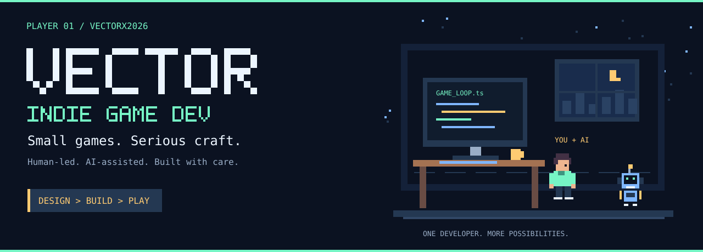

  

### Hi, I'm Vector 👋

**Independent game developer · Cocos Creator / TypeScript · Android & mini games**

I turn small ideas into playable games, from the core loop and progression to UI, animation and platform integration.

独立开发者。关注玩法手感、清晰的界面，以及从原型到可玩版本的每一步。

- **Gameplay first** — prototypes, progression systems, balancing and playtesting.
- **Made for small screens** — mobile UI, animation and performance-conscious implementation.
- **Beyond the game loop** — Android bridges, ads, billing and platform integration.

#### From the public archive

| Project | What it explores |
| :--- | :--- |
| [BomberMan](https://github.com/VectorX2026/BomberMan) | A small Bomberman game in C++. |
| [excel-analyze](https://github.com/VectorX2026/excel-analyze) | Turning spreadsheet data into game-friendly formats. |

*Some current work lives in private repositories. Public demos will appear here when ready.*

**One developer. More possibilities.**

I set the direction, make the trade-offs and judge the result. My AI collaborator helps turn that direction into something tangible:

`Research → Design → Build → Test → Iterate`

- Explore mechanics and turn scattered ideas into maintainable design documents.
- Draft code, produce visual concepts and investigate implementation problems.
- Review changes, automate checks and keep iteration grounded in evidence.

**Human taste. AI leverage. Real verification.** No claims of autonomous perfection, just a better way to build.

**Game** · Cocos Creator · TypeScript · JavaScript  
**Mobile** · Android · Java · Google Play · WeChat Mini Games  
**Workflow** · Git · GitHub · AI-assisted development

---

Keep the scope small. Make the experience count.

